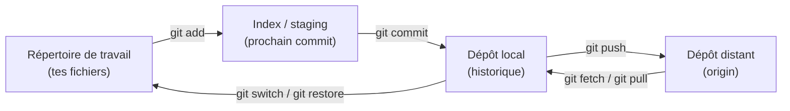
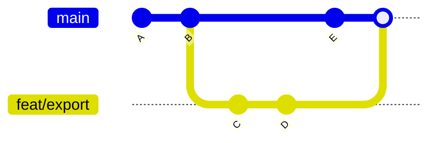
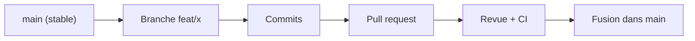
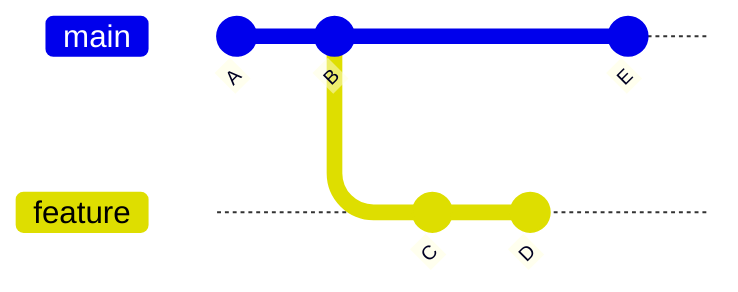

# howtogit — Le guide Git, du débutant à l'avancé

> Guide de référence pour comprendre et utiliser Git au quotidien : le modèle mental, les commandes essentielles, les branches, la fusion, l'annulation d'erreurs, les outils avancés et le dépannage. Chaque section se lit indépendamment. Pour écrire de bons messages de commit et de bonnes pull requests, voir `howtocommit.md`.

## Comment utiliser ce guide

| Je veux… | Va à… |
| --- | --- |
| Comprendre ce que fait Git | [A. Comprendre Git](#a-comprendre-git) |
| Configurer Git sur ma machine | [B. Installation et configuration](#b-installation-et-configuration) |
| Les commandes de tous les jours | [C. Les commandes de base](#c-les-commandes-de-base) |
| Travailler avec des branches | [D. Les branches](#d-les-branches) et [E. Stratégies de branches](#e-stratégies-de-branches) |
| Fusionner ou rebaser, résoudre un conflit | [F. Fusionner, rebaser et résoudre les conflits](#f-fusionner-rebaser-et-résoudre-les-conflits) |
| **Annuler une erreur** | [G. Annuler et corriger](#g-annuler-et-corriger) |
| `stash`, `cherry-pick`, `bisect`… | [H. Outils avancés](#h-outils-avancés) |
| Comprendre un message d'erreur | [J. Dépannage](#j-dépannage) |
| Un aide-mémoire à garder sous la main | [K. Aide-mémoire](#k-aide-mémoire) |

**Conventions du guide.**

- Les commandes sont dans des blocs `bash`. Les valeurs à remplacer sont en `MAJUSCULES` ou entre chevrons.
- Les commandes qui **détruisent ou réécrivent** des données sont précédées d'un avertissement. Lis-les avant de les lancer.
- `main` désigne la branche principale. Dans certains dépôts elle s'appelle `master` ou autrement : adapte.
- Les commandes `git switch` et `git restore` (Git 2.23 et plus récent) remplacent les usages les plus confus de `git checkout`. L'ancienne syntaxe reste valable.

## Table des matières

- [Comment utiliser ce guide](#comment-utiliser-ce-guide)
- [A. Comprendre Git](#a-comprendre-git)
  - [A.1 Ce que fait Git](#a1-ce-que-fait-git)
  - [A.2 Distribué : chaque copie est un dépôt complet](#a2-distribué--chaque-copie-est-un-dépôt-complet)
  - [A.3 Les trois zones (le modèle mental essentiel)](#a3-les-trois-zones-le-modèle-mental-essentiel)
  - [A.4 Les notions clés](#a4-les-notions-clés)
- [B. Installation et configuration](#b-installation-et-configuration)
  - [B.1 Installer Git](#b1-installer-git)
  - [B.2 Configuration initiale (à faire une fois)](#b2-configuration-initiale-à-faire-une-fois)
  - [B.3 Alias utiles](#b3-alias-utiles)
  - [B.4 S'authentifier auprès de GitHub](#b4-sauthentifier-auprès-de-github)
  - [B.5 Ignorer des fichiers : .gitignore](#b5-ignorer-des-fichiers--gitignore)
  - [B.6 Fins de ligne (Windows, Linux, macOS)](#b6-fins-de-ligne-windows-linux-macos)
- [C. Les commandes de base](#c-les-commandes-de-base)
  - [C.1 Démarrer un dépôt](#c1-démarrer-un-dépôt)
  - [C.2 Le cycle quotidien](#c2-le-cycle-quotidien)
  - [C.3 Regarder ce qui se passe](#c3-regarder-ce-qui-se-passe)
  - [C.4 Déplacer, renommer, supprimer des fichiers](#c4-déplacer-renommer-supprimer-des-fichiers)
  - [C.5 Synchroniser avec un dépôt distant](#c5-synchroniser-avec-un-dépôt-distant)
- [D. Les branches](#d-les-branches)
  - [D.1 Les commandes essentielles](#d1-les-commandes-essentielles)
  - [D.2 Suivi des branches distantes](#d2-suivi-des-branches-distantes)
  - [D.3 L'état « detached HEAD »](#d3-létat--detached-head-)
  - [D.4 Nommer ses branches](#d4-nommer-ses-branches)
- [E. Stratégies de branches](#e-stratégies-de-branches)
  - [E.1 Les trois modèles courants](#e1-les-trois-modèles-courants)
  - [E.2 GitHub flow en pratique](#e2-github-flow-en-pratique)
  - [E.3 Branches de longue durée : le piège](#e3-branches-de-longue-durée--le-piège)
- [F. Fusionner, rebaser et résoudre les conflits](#f-fusionner-rebaser-et-résoudre-les-conflits)
  - [F.1 Fusionner avec merge](#f1-fusionner-avec-merge)
  - [F.2 Rejouer avec rebase](#f2-rejouer-avec-rebase)
  - [F.3 merge ou rebase ?](#f3-merge-ou-rebase-)
  - [F.4 Le rebase interactif : réécrire ses commits locaux](#f4-le-rebase-interactif--réécrire-ses-commits-locaux)
  - [F.5 Résoudre un conflit, pas à pas](#f5-résoudre-un-conflit-pas-à-pas)
- [G. Annuler et corriger](#g-annuler-et-corriger)
  - [G.1 Quelle commande pour quelle situation](#g1-quelle-commande-pour-quelle-situation)
  - [G.2 restore : défaire des modifications de fichiers](#g2-restore--défaire-des-modifications-de-fichiers)
  - [G.3 reset : déplacer la branche](#g3-reset--déplacer-la-branche)
  - [G.4 revert : annuler sans réécrire l'historique](#g4-revert--annuler-sans-réécrire-lhistorique)
  - [G.5 amend : retoucher le dernier commit](#g5-amend--retoucher-le-dernier-commit)
  - [G.6 reflog : le filet de sécurité](#g6-reflog--le-filet-de-sécurité)
  - [G.7 clean : supprimer les fichiers non suivis](#g7-clean--supprimer-les-fichiers-non-suivis)
  - [G.8 J'ai poussé quelque chose que je ne voulais pas](#g8-jai-poussé-quelque-chose-que-je-ne-voulais-pas)
- [H. Outils avancés](#h-outils-avancés)
  - [H.1 stash : mettre du travail de côté](#h1-stash--mettre-du-travail-de-côté)
  - [H.2 cherry-pick : prendre un commit d'ailleurs](#h2-cherry-pick--prendre-un-commit-dailleurs)
  - [H.3 bisect : retrouver le commit qui a cassé quelque chose](#h3-bisect--retrouver-le-commit-qui-a-cassé-quelque-chose)
  - [H.4 blame et log pour comprendre le code](#h4-blame-et-log-pour-comprendre-le-code)
  - [H.5 Tags : marquer des versions](#h5-tags--marquer-des-versions)
  - [H.6 worktree : plusieurs branches en même temps](#h6-worktree--plusieurs-branches-en-même-temps)
  - [H.7 Sous-modules](#h7-sous-modules)
  - [H.8 Hooks : automatiser des contrôles](#h8-hooks--automatiser-des-contrôles)
  - [H.9 Autres commandes qui rendent service](#h9-autres-commandes-qui-rendent-service)
- [I. Travailler avec des dépôts distants](#i-travailler-avec-des-dépôts-distants)
  - [I.1 Fork et dépôt upstream](#i1-fork-et-dépôt-upstream)
  - [I.2 Pousser proprement](#i2-pousser-proprement)
  - [I.3 Plusieurs remotes et nettoyage](#i3-plusieurs-remotes-et-nettoyage)
  - [I.4 Quand push est refusé](#i4-quand-push-est-refusé)
- [J. Dépannage](#j-dépannage)
  - [J.1 Messages d'erreur courants](#j1-messages-derreur-courants)
  - [J.2 Je suis perdu : la démarche de diagnostic](#j2-je-suis-perdu--la-démarche-de-diagnostic)
  - [J.3 Un rebase ou un merge a tourné mal](#j3-un-rebase-ou-un-merge-a-tourné-mal)
  - [J.4 Un commit sur la mauvaise branche](#j4-un-commit-sur-la-mauvaise-branche)
  - [J.5 Un fichier énorme ou un secret commité](#j5-un-fichier-énorme-ou-un-secret-commité)
- [K. Aide-mémoire](#k-aide-mémoire)
  - [K.1 Les commandes d'une page](#k1-les-commandes-dune-page)
  - [K.2 Le cycle d'une fonctionnalité en équipe](#k2-le-cycle-dune-fonctionnalité-en-équipe)
  - [K.3 Trouver la bonne commande : « je veux… »](#k3-trouver-la-bonne-commande---je-veux-)
- [L. Erreurs fréquentes et checklist](#l-erreurs-fréquentes-et-checklist)
  - [L.1 Les erreurs courantes](#l1-les-erreurs-courantes)
  - [L.2 Checklist avant de pousser](#l2-checklist-avant-de-pousser)
  - [L.3 Checklist de configuration d'une nouvelle machine](#l3-checklist-de-configuration-dune-nouvelle-machine)
- [M. Sources et limites](#m-sources-et-limites)


---

## A. Comprendre Git

### A.1 Ce que fait Git

Git est un **système de gestion de versions distribué**. Il enregistre l'historique de ton projet sous forme de **commits** (des instantanés), te permet de **travailler en parallèle** sur des **branches** et de **synchroniser** ton travail avec d'autres copies du dépôt.

| Git te permet de… | Grâce à… |
| --- | --- |
| Revenir à un état précédent | l'historique des commits |
| Essayer une idée sans risque | les branches |
| Travailler à plusieurs | les dépôts distants, les fusions |
| Savoir qui a changé quoi, quand et pourquoi | `log`, `blame`, les messages de commit |
| Retrouver quel commit a introduit un bug | `bisect` |

**Git n'est pas GitHub.** Git est l'outil local, installé sur ta machine. GitHub, GitLab et d'autres sont des **services d'hébergement** de dépôts Git, avec des fonctions en plus (pull requests, issues, CI).

### A.2 Distribué : chaque copie est un dépôt complet

Quand tu clones un dépôt, tu obtiens **tout l'historique**, pas seulement la dernière version. Tu peux committer, créer des branches, consulter l'historique **sans connexion**. La synchronisation avec un autre dépôt (`origin` en général) est une étape séparée : `fetch`, `pull`, `push`.

### A.3 Les trois zones (le modèle mental essentiel)



| Zone | Contenu | Pour y voir clair |
| --- | --- | --- |
| **Répertoire de travail** | Les fichiers tels que tu les édites | `git status` |
| **Index (staging area)** | Ce qui sera dans le **prochain commit** | `git diff --staged` |
| **Dépôt local** | Les commits enregistrés | `git log` |
| **Dépôt distant** | Une copie hébergée (GitHub…) | `git fetch` puis `git log origin/main` |

L'index est ce qui distingue Git de beaucoup d'autres outils : tu **choisis** ce qui entre dans chaque commit avec `git add`, au lieu de tout enregistrer d'un bloc.

### A.4 Les notions clés

| Notion | Définition |
| --- | --- |
| **Commit** | Un instantané du projet, avec un identifiant (hash), un auteur, une date, un message et un lien vers son ou ses parents |
| **Hash** | L'identifiant unique d'un commit (`1a2b3c4…`). Les 7 premiers caractères suffisent en général |
| **Branche** | Un **pointeur léger et déplaçable** vers un commit. Créer une branche ne copie rien |
| **`HEAD`** | Le pointeur « là où je suis » : en général la branche courante |
| **Remote** | Un dépôt distant référencé par un nom (`origin`) |
| **Branche de suivi** | `origin/main` : ta copie locale de l'état de `main` sur `origin` (mise à jour par `fetch`) |
| **Tag** | Une étiquette fixe sur un commit (par exemple une version `v1.2.0`) |
| **Fast-forward** | Avancer un pointeur de branche sans créer de nouveau commit |



---

## B. Installation et configuration

### B.1 Installer Git

| Système | Méthode |
| --- | --- |
| Linux (Debian/Ubuntu) | `sudo apt install git` |
| Linux (Fedora) | `sudo dnf install git` |
| macOS | `brew install git`, ou les outils de ligne de commande Xcode |
| Windows | Git for Windows (inclut Git Bash), ou WSL avec la méthode Linux |

```bash
git --version
```

### B.2 Configuration initiale (à faire une fois)

Git associe ton **identité** à chaque commit. Les niveaux de configuration sont : `--system` (machine), `--global` (ton utilisateur), `--local` (ce dépôt, le défaut dans un dépôt).

```bash
git config --global user.name "Prénom Nom"
git config --global user.email "ton-adresse@example.com"
git config --global init.defaultBranch main
git config --global core.editor "nano"          # ou "code --wait", "vim"…
```

> [!NOTE]
> **Confidentialité de l'adresse e-mail :** l'adresse de `user.email` est visible dans l'historique des commits publics. GitHub propose une adresse « no-reply » dans les paramètres de ton compte à utiliser à la place d'une adresse personnelle.

Réglages recommandés :

```bash
git config --global pull.rebase false           # ou true selon ta préférence (voir F.3)
git config --global push.autoSetupRemote true   # le premier push crée le suivi tout seul
git config --global fetch.prune true            # nettoie les branches distantes supprimées
git config --global rerere.enabled true         # mémorise la résolution des conflits répétés
```

Afficher la configuration :

```bash
git config --list --show-origin
git config user.email
```

### B.3 Alias utiles

Les alias raccourcissent les commandes fréquentes :

```bash
git config --global alias.st "status -sb"
git config --global alias.lg "log --oneline --graph --decorate --all"
git config --global alias.last "log -1 HEAD --stat"
git config --global alias.unstage "restore --staged"
```

Utilisation : `git st`, `git lg`, `git unstage FICHIER`.

### B.4 S'authentifier auprès de GitHub

| Méthode | Principe | Quand |
| --- | --- | --- |
| **SSH** | Une paire de clés ; la clé publique est enregistrée sur GitHub | Recommandé au quotidien sur sa propre machine |
| **HTTPS + gestionnaire d'identifiants** | Un jeton d'accès personnel (pas le mot de passe du compte) conservé par un « credential helper » | Quand SSH est bloqué (certains réseaux) |
| **GitHub CLI** (`gh auth login`) | Configure l'authentification pour toi | Pratique si tu utilises déjà `gh` |

Générer une clé SSH moderne :

```bash
ssh-keygen -t ed25519 -C "ton-adresse@example.com"
cat ~/.ssh/id_ed25519.pub        # copie la clé PUBLIQUE dans GitHub > Settings > SSH keys
ssh -T git@github.com            # teste la connexion
```

> [!CAUTION]
> Ne partage, ne commite et ne colle **jamais** la clé **privée** (`id_ed25519`, sans `.pub`). Protège-la avec une phrase secrète.

### B.5 Ignorer des fichiers : `.gitignore`

Le fichier `.gitignore` liste ce que Git ne doit **pas** suivre : fichiers générés, dépendances, secrets, fichiers d'éditeur.

```gitignore
# Dépendances et builds
node_modules/
dist/
*.o
a.out

# Environnement et secrets
.env
*.pem

# Éditeur et système
.vscode/
.idea/
.DS_Store
```

| Motif | Signification |
| --- | --- |
| `*.log` | Tous les fichiers `.log` |
| `build/` | Le dossier `build` et son contenu |
| `!important.log` | Exception : suit ce fichier malgré une règle précédente |
| `/todo.txt` | Seulement à la racine du dépôt |
| `**/temp` | Un dossier `temp` à n'importe quelle profondeur |

Points importants :

- `.gitignore` n'agit que sur les fichiers **non encore suivis**. Pour arrêter de suivre un fichier déjà commité : `git rm --cached FICHIER`, puis commit.
- Un **`.gitignore` global** (`git config --global core.excludesFile ~/.gitignore_global`) évite de répéter les fichiers propres à ta machine dans chaque dépôt.
- Ignorer un secret **n'efface pas** l'historique s'il a déjà été commité (voir le guide `howtosecurerepo.md`).

### B.6 Fins de ligne (Windows, Linux, macOS)

Windows termine les lignes par `CRLF`, Linux et macOS par `LF`. Un message comme `LF will be replaced by CRLF` est un avertissement de conversion. Pour un projet partagé, le plus simple est un fichier **`.gitattributes`** à la racine :

```gitattributes
* text=auto
*.sh text eol=lf
```

---

## C. Les commandes de base

### C.1 Démarrer un dépôt

```bash
git init                                    # transforme le dossier courant en dépôt
git clone https://github.com/OWNER/REPO.git # copie un dépôt existant
git clone git@github.com:OWNER/REPO.git     # la même chose en SSH
```

### C.2 Le cycle quotidien

```bash
git status                  # où en suis-je ?
git add src/main.c          # indexe un fichier
git add -p                  # indexe morceau par morceau (interactif)
git commit -m "feat: add CSV export"
git push                    # envoie vers le dépôt distant
git pull                    # récupère et intègre les changements distants
```

| Commande | Effet | À savoir |
| --- | --- | --- |
| `git status` | Montre fichiers modifiés, indexés, non suivis | La première commande à taper en cas de doute |
| `git add FICHIER` | Ajoute à l'index | `git add .` ajoute tout le dossier : relis `git status` avant |
| `git add -p` | Choix interactif des morceaux | Permet des commits atomiques |
| `git commit -m "MSG"` | Crée un commit avec ce qui est indexé | Sans `-m`, ouvre l'éditeur |
| `git commit -a` | Indexe les fichiers déjà suivis puis commit | N'ajoute pas les nouveaux fichiers |
| `git push` | Envoie les commits vers le remote | Refusé si le remote a de nouveaux commits (voir F) |
| `git pull` | `fetch` + intégration (merge ou rebase) | Préfère `fetch` puis décision quand tu veux contrôler |

### C.3 Regarder ce qui se passe

```bash
git diff                    # modifications non indexées
git diff --staged           # modifications indexées (ce qui ira dans le commit)
git diff main..feat/export  # différences entre deux branches
git log --oneline           # historique compact
git log --oneline --graph --all
git show 1a2b3c4            # détail d'un commit
git show HEAD~2:src/main.c  # un fichier tel qu'il était il y a 2 commits
```

Références relatives : `HEAD` (commit courant), `HEAD~1` ou `HEAD^` (le parent), `HEAD~3` (trois commits avant), `main@{yesterday}` (position d'hier).

Filtrer l'historique :

```bash
git log --author="Prénom"          # par auteur
git log --since="2 weeks ago"      # par date
git log -- chemin/du/fichier       # commits touchant un fichier
git log -S"nom_de_fonction"        # commits qui ajoutent/retirent ce texte
git log --grep="^feat"             # par message
```

### C.4 Déplacer, renommer, supprimer des fichiers

```bash
git mv ancien.c nouveau.c       # renomme (Git détecte aussi les renommages faits à la main)
git rm fichier.c                # supprime et indexe la suppression
git rm --cached fichier.log     # arrête de suivre sans supprimer le fichier du disque
```

### C.5 Synchroniser avec un dépôt distant

```bash
git remote -v                          # liste les remotes
git remote add origin URL              # ajoute un remote
git fetch                              # télécharge sans modifier ta branche
git fetch --prune                      # et nettoie les branches supprimées côté distant
git pull                               # fetch + intégration
git push -u origin ma-branche          # premier push : crée le suivi
```

**`fetch` ou `pull` ?** `git fetch` met à jour tes copies `origin/*` **sans toucher** à ton travail : tu peux ensuite regarder (`git log HEAD..origin/main`) puis décider de fusionner ou de rebaser. `git pull` fait les deux d'un coup.

---

## D. Les branches

Une branche est un **pointeur** vers un commit : en créer une est instantané et ne copie rien.

### D.1 Les commandes essentielles

```bash
git branch                       # liste les branches locales (* = courante)
git branch -a                    # inclut les branches distantes
git switch -c feat/csv-export    # crée ET bascule sur la nouvelle branche
git switch main                  # bascule sur une branche existante
git switch -                     # revient à la branche précédente
git branch -m ancien nouveau     # renomme
git branch -d feat/csv-export    # supprime (refuse si non fusionnée)
git branch -D feat/csv-export    # supprime de force
git push origin --delete feat/csv-export   # supprime la branche distante
```

Créer une branche depuis un commit ou un tag précis :

```bash
git switch -c fix/old-bug 1a2b3c4
git switch -c hotfix v1.2.0
```

### D.2 Suivi des branches distantes

```bash
git branch -vv                   # montre quelle branche suit quelle branche distante
git branch -u origin/main        # définit le suivi de la branche courante
git switch feat/export           # si origin/feat/export existe, crée la branche locale qui la suit
```

### D.3 L'état « detached HEAD »

Quand tu te places sur un commit ou un tag plutôt que sur une branche (`git switch --detach 1a2b3c4`, ou `git checkout 1a2b3c4`), `HEAD` ne pointe plus vers une branche : c'est l'état **detached HEAD**. Tu peux regarder, tester, mais les nouveaux commits n'appartiennent à **aucune branche** et seront perdus en revenant ailleurs.

Pour garder ton travail : `git switch -c nouvelle-branche`.

### D.4 Nommer ses branches

| Préfixe | Usage | Exemple |
| --- | --- | --- |
| `feat/` | Nouvelle fonctionnalité | `feat/csv-export` |
| `fix/` | Correction | `fix/empty-input` |
| `docs/` | Documentation | `docs/readme` |
| `refactor/` | Refonte | `refactor/parser` |
| `chore/` | Maintenance | `chore/update-deps` |
| `hotfix/` | Correctif urgent en production | `hotfix/login-crash` |

Bonnes habitudes : minuscules, tirets, courts mais explicites, un **sujet par branche**, pas d'espaces. Si ton équipe référence les issues : `feat/12-csv-export`.

---

## E. Stratégies de branches

Une **stratégie de branches** est une convention d'équipe sur *comment* utiliser les branches. Il n'y a pas de bonne réponse universelle ; il y en a une adaptée à la taille de l'équipe et au rythme de livraison.

### E.1 Les trois modèles courants

| Modèle | Principe | Convient à | Inconvénient |
| --- | --- | --- | --- |
| **GitHub flow** | `main` toujours déployable ; une branche courte par sujet ; PR ; fusion | La plupart des équipes et projets web, projets d'école | Moins adapté si on maintient plusieurs versions en parallèle |
| **Trunk-based development** | Tous travaillent sur `main` (ou branches très courtes, de quelques heures) ; fonctionnalités cachées derrière des *feature flags* | Équipes avec CI solide, déploiement continu | Demande de la discipline et de bons tests |
| **Git flow** | Branches `main`, `develop`, `feature/*`, `release/*`, `hotfix/*` | Logiciels avec versions publiées et maintenues en parallèle | Lourd, beaucoup de fusions ; excessif pour un petit projet |

### E.2 GitHub flow en pratique



1. Pars de `main` à jour.
2. Crée une branche par sujet.
3. Committe, pousse, ouvre une pull request.
4. Relecture et vérifications automatiques.
5. Fusionne dans `main`, supprime la branche.

**Conseil :** pour un projet d'école ou une petite équipe, commence par le **GitHub flow**. Ajoute une branche `develop` seulement si un vrai besoin (versions parallèles, intégration préalable) apparaît.

### E.3 Branches de longue durée : le piège

Plus une branche vit longtemps, plus elle **diverge** de `main` et plus la fusion devient douloureuse. Règle pratique : **branches courtes** (quelques jours), mises à jour régulièrement avec `main` (voir F), et fonctionnalités découpées en petites PR.


---

## F. Fusionner, rebaser et résoudre les conflits

### F.1 Fusionner avec `merge`

`git merge` intègre les commits d'une branche dans la branche courante.

```bash
git switch main
git merge feat/csv-export
```

| Cas | Ce qui se passe |
| --- | --- |
| **Fast-forward** | `main` n'a pas avancé depuis la création de la branche : Git déplace simplement le pointeur, sans commit de fusion |
| **Merge commit** | Les deux branches ont avancé : Git crée un commit de fusion à deux parents |
| **Conflit** | Les deux branches ont modifié les mêmes lignes : Git s'arrête et te demande de trancher |

Options utiles :

```bash
git merge --no-ff feat/x     # force un commit de fusion, même si un fast-forward est possible
git merge --squash feat/x    # applique les changements en un bloc, à committer toi-même
git merge --abort            # annule une fusion en cours (conflit)
```

### F.2 Rejouer avec `rebase`

`git rebase` **rejoue** tes commits par-dessus une autre base, pour donner un historique linéaire.

```bash
git switch feat/csv-export
git fetch origin
git rebase origin/main
```



Avant le rebase, `feature` part de `B`. Après `git rebase main` depuis `feature`, les commits `C` et `D` sont **recréés** (avec de nouveaux hash) à la suite de `E`.

> [!WARNING]
> **La règle d'or du rebase :** ne rebase jamais des commits qui ont déjà été **poussés et partagés** avec d'autres (par exemple `main`). Un rebase réécrit les hash : les autres se retrouvent avec un historique divergent. Sur **ta propre** branche de travail, c'est acceptable (suivi d'un `git push --force-with-lease`).

```bash
git rebase --continue        # après avoir résolu un conflit
git rebase --skip            # ignore le commit courant
git rebase --abort           # annule tout et revient à l'état d'avant
```

### F.3 `merge` ou `rebase` ?

| | `merge` | `rebase` |
| --- | --- | --- |
| **Historique** | Conserve la vraie chronologie, avec commits de fusion | Linéaire et propre |
| **Sécurité** | Ne modifie aucun commit existant | Réécrit les commits (nouveaux hash) |
| **Conflits** | Une résolution pour toute la fusion | Possibles à chaque commit rejoué |
| **Quand l'utiliser** | Intégrer une branche terminée ; branche partagée | Mettre à jour **ta** branche avec `main` avant PR |

**Règle simple :** `rebase` pour **tenir ta branche à jour** avant la PR, `merge` (ou le bouton de la PR) pour **intégrer dans `main`**. Suis la convention de ton équipe.

Pour `git pull`, tu peux choisir une fois pour toutes :

```bash
git config --global pull.rebase false    # pull = fetch + merge (comportement classique)
git config --global pull.rebase true     # pull = fetch + rebase
git config --global pull.ff only         # refuse tout ce qui n'est pas un fast-forward
```

### F.4 Le rebase interactif : réécrire ses commits locaux

Pour nettoyer ta branche avant une PR :

```bash
git rebase -i HEAD~4        # édite les 4 derniers commits
git rebase -i origin/main   # édite tous les commits depuis main
```

Git ouvre une liste ; change le mot au début de chaque ligne :

| Commande | Effet |
| --- | --- |
| `pick` | Garde le commit tel quel |
| `reword` | Garde le commit, change son message |
| `edit` | S'arrête sur ce commit pour le modifier |
| `squash` | Fusionne avec le commit précédent, en combinant les messages |
| `fixup` | Fusionne avec le précédent, en jetant ce message |
| `drop` | Supprime le commit |

Raccourci pour corriger un commit ancien :

```bash
git commit --fixup 1a2b3c4              # prépare une correction du commit 1a2b3c4
git rebase -i --autosquash origin/main  # place et fusionne automatiquement les fixup
```

### F.5 Résoudre un conflit, pas à pas

Un conflit apparaît quand Git ne peut pas combiner automatiquement deux modifications. Il marque le fichier :

```text
<<<<<<< HEAD
const timeout = 5000;
=======
const timeout = 10000;
>>>>>>> feat/csv-export
```

- Entre `<<<<<<<` et `=======` : **ta version** (la branche courante).
- Entre `=======` et `>>>>>>>` : **la version entrante**.

Procédure :

1. `git status` : liste les fichiers « both modified ».
2. Ouvre chaque fichier, **choisis ou combine** les versions, **supprime les trois marqueurs**.
3. `git add FICHIER` pour signaler que c'est résolu.
4. Termine : `git commit` (pour un merge) ou `git rebase --continue` (pour un rebase).
5. **Relance les tests** : un conflit résolu mais mal combiné peut compiler et pourtant casser le comportement.

Outils :

```bash
git diff --name-only --diff-filter=U    # liste les fichiers encore en conflit
git checkout --ours FICHIER             # garde ta version (attention : pendant un rebase, ours/theirs sont inversés)
git checkout --theirs FICHIER           # garde la version entrante
git mergetool                           # ouvre l'outil de fusion configuré
```

> [!NOTE]
> Pendant un **rebase**, « ours » désigne la branche sur laquelle tu rejoues (par exemple `main`) et « theirs » tes propres commits : c'est l'inverse d'un merge. En cas de doute, ouvre le fichier et lis-le.

**Éviter les conflits :** commits et PR petits, mise à jour fréquente avec `main`, communication d'équipe sur les fichiers touchés, formatage automatique commun.

---

## G. Annuler et corriger

C'est la section qui sauve. Le bon outil dépend de **où en est la modification** (non indexée, indexée, commitée, poussée).

### G.1 Quelle commande pour quelle situation

| Situation | Commande | Sans danger ? |
| --- | --- | --- |
| Annuler mes modifications **non indexées** d'un fichier | `git restore FICHIER` | **Perd** ces modifications |
| **Désindexer** un fichier (annuler `git add`) | `git restore --staged FICHIER` | Oui, garde le contenu |
| Corriger le **message** du dernier commit | `git commit --amend` | Oui si non poussé |
| Ajouter un oubli au **dernier commit** | `git add F` puis `git commit --amend --no-edit` | Oui si non poussé |
| Annuler le dernier commit, **garder les modifications indexées** | `git reset --soft HEAD~1` | Oui |
| Annuler le dernier commit, **garder les modifications non indexées** | `git reset HEAD~1` (= `--mixed`) | Oui |
| Annuler le dernier commit **et tout perdre** | `git reset --hard HEAD~1` | **Destructif** |
| Annuler un commit **déjà poussé** | `git revert 1a2b3c4` | Oui : crée un commit d'annulation |
| Revenir à un fichier d'un ancien commit | `git restore --source=1a2b3c4 FICHIER` | Écrase le fichier courant |
| Récupérer un commit « perdu » | `git reflog` puis `git switch -c rescue 1a2b3c4` | Oui |
| Supprimer les fichiers **non suivis** | `git clean -n` (aperçu) puis `git clean -fd` | `-fd` est **destructif** |

### G.2 `restore` : défaire des modifications de fichiers

```bash
git restore src/main.c                    # annule les modifs non indexées (perte !)
git restore --staged src/main.c           # retire du prochain commit, garde les modifs
git restore --source=HEAD~2 src/main.c    # remet le fichier tel qu'il était 2 commits avant
```

> [!WARNING]
> `git restore FICHIER` **écrase** tes modifications locales sans possibilité de retour (elles n'ont jamais été commitées). Vérifie avec `git diff FICHIER` d'abord.

### G.3 `reset` : déplacer la branche

`git reset` déplace la **branche courante** vers un autre commit. Trois modes selon ce qu'il fait des modifications :

| Mode | Déplace la branche | Index | Fichiers de travail |
| --- | --- | --- | --- |
| `--soft` | Oui | **Conservé** (changements restent indexés) | Conservés |
| `--mixed` (défaut) | Oui | **Réinitialisé** | Conservés |
| `--hard` | Oui | Réinitialisé | **Écrasés** |

```bash
git reset --soft HEAD~1      # « défait » le commit, tout reste prêt à être recommité
git reset HEAD~1             # « défait » le commit, les modifs restent dans les fichiers
git reset --hard HEAD~1      # DÉTRUIT le commit et les modifications
```

> [!WARNING]
> `git reset` sur des commits **déjà poussés** réécrit l'historique partagé. Pour annuler du travail déjà publié, utilise `git revert`.

### G.4 `revert` : annuler sans réécrire l'historique

`git revert` crée un **nouveau commit** qui défait un commit précédent. L'historique est conservé : c'est la méthode **sûre** pour du code déjà poussé.

```bash
git revert 1a2b3c4              # annule ce commit
git revert HEAD                 # annule le dernier commit
git revert -m 1 MERGE_HASH      # annule un commit de fusion (garde le parent 1)
git revert --no-edit 1a2b3c4    # sans ouvrir l'éditeur
```

### G.5 `amend` : retoucher le dernier commit

```bash
git commit --amend                     # modifier le message
git add oublie.c
git commit --amend --no-edit           # ajouter un fichier oublié, garder le message
```

`--amend` **remplace** le dernier commit par un nouveau (hash différent). À ne faire que **avant** de pousser, ou sur une branche que tu es seul à utiliser.

### G.6 `reflog` : le filet de sécurité

Git garde un **journal de tous les déplacements de `HEAD`** (commits, resets, rebases, changements de branche). Même après un `reset --hard` ou un rebase raté, les commits restent récupérables pendant un certain temps (environ 90 jours par défaut pour les entrées accessibles, moins pour les commits orphelins).

```bash
git reflog                            # affiche l'historique des positions de HEAD
git switch -c rescue HEAD@{3}         # recrée une branche sur l'état d'il y a 3 mouvements
git reset --hard HEAD@{1}             # revient à la position précédente (destructif)
```

Exemple de récupération après un `git reset --hard` accidentel :

```text
$ git reflog
a1b2c3d HEAD@{0}: reset: moving to HEAD~2
f4e5d6c HEAD@{1}: commit: feat: add export        <- le commit « perdu »
9a8b7c6 HEAD@{2}: commit: fix: handle null user
```

```bash
git switch -c recovery f4e5d6c
```

> [!TIP]
> Le reflog est **local** : il n'existe pas sur le dépôt distant, et il ne protège pas des modifications qui n'ont jamais été commitées. **Committe souvent** : un commit, même provisoire, est récupérable ; une modification non commitée ne l'est pas.

### G.7 `clean` : supprimer les fichiers non suivis

```bash
git clean -n         # aperçu : ce qui SERAIT supprimé
git clean -fd        # supprime fichiers et dossiers non suivis (irréversible)
git clean -fdx       # supprime aussi les fichiers ignorés (compilations, .env…)
```

> [!CAUTION]
> `git clean -fdx` supprime aussi tes fichiers ignorés, y compris un `.env` local ou des données. Lance toujours `git clean -n` avant.

### G.8 J'ai poussé quelque chose que je ne voulais pas

| Ce qui a été poussé | Que faire |
| --- | --- |
| Un mauvais commit, sans conséquence | `git revert` : propre et sûr |
| Un **secret** (clé, mot de passe) | **Révoque-le immédiatement**, puis suis la procédure du guide `howtosecurerepo.md` ; le supprimer d'un commit ultérieur ne suffit pas |
| Un message de commit faux, sur ta branche perso | `git commit --amend` puis `git push --force-with-lease` |
| Un gros fichier par erreur | Retire-le, puis réécris l'historique avec un outil dédié (`git filter-repo`) si nécessaire |

---

## H. Outils avancés

### H.1 `stash` : mettre du travail de côté

Tu as des modifications en cours et dois changer de branche ? `git stash` les range provisoirement.

```bash
git stash                          # range les modifications suivies
git stash push -u -m "WIP export"  # inclut les fichiers non suivis (-u) et ajoute un nom
git stash list                     # liste les « tiroirs »
git stash pop                      # réapplique le dernier et le supprime
git stash apply stash@{1}          # réapplique sans supprimer
git stash drop stash@{0}           # supprime un tiroir
git stash branch fix/idea          # crée une branche depuis le stash
```

Le stash est **local** et peut être oublié : ne le laisse pas s'accumuler. Pour un travail qui dure, un vrai commit sur une branche est plus sûr.

### H.2 `cherry-pick` : prendre un commit d'ailleurs

Applique **un commit précis** d'une autre branche sur la branche courante (utile pour reporter un correctif).

```bash
git switch main
git cherry-pick 1a2b3c4              # applique ce commit ici
git cherry-pick A..B                 # une plage de commits
git cherry-pick --continue           # après résolution d'un conflit
```

Le commit appliqué a un **nouveau hash** : l'historique contiendra deux commits identiques en contenu. À utiliser avec modération.

### H.3 `bisect` : retrouver le commit qui a cassé quelque chose

`git bisect` fait une **recherche dichotomique** dans l'historique entre un commit bon et un commit mauvais.

```bash
git bisect start
git bisect bad                  # le commit actuel est cassé
git bisect good v1.2.0          # cette version fonctionnait
# Git te place au milieu : teste, puis réponds :
git bisect good                 # ou : git bisect bad
# ...répète jusqu'à ce que Git désigne le commit fautif
git bisect reset                # revient à ta branche
```

Automatiser avec un script de test (code de retour 0 = bon) :

```bash
git bisect run ./scripts/test.sh
```

Atout des commits **atomiques** : le commit désigné est petit et lisible.

### H.4 `blame` et `log` pour comprendre le code

```bash
git blame src/main.c               # qui a modifié chaque ligne, dans quel commit
git blame -L 10,20 src/main.c      # seulement les lignes 10 à 20
git log -p -- src/main.c           # historique détaillé d'un fichier, avec les diffs
git log -S"timeout" --oneline      # commits qui ajoutent ou retirent le mot « timeout »
git log --follow -- src/main.c     # suit le fichier à travers les renommages
```

### H.5 Tags : marquer des versions

Un **tag** est une étiquette fixe sur un commit, typiquement une version (voir le versionnement sémantique).

```bash
git tag v1.2.0                            # tag léger
git tag -a v1.2.0 -m "Version 1.2.0"      # tag annoté (recommandé pour les versions)
git tag                                   # liste
git push origin v1.2.0                    # un tag ne part pas avec un push classique
git push origin --tags                    # pousse tous les tags
git tag -d v1.2.0                         # supprime en local
```

### H.6 `worktree` : plusieurs branches en même temps

`git worktree` crée un **second dossier de travail** lié au même dépôt, pour travailler sur deux branches sans changer de branche ni stasher.

```bash
git worktree add ../projet-hotfix hotfix/login-crash
git worktree list
git worktree remove ../projet-hotfix
```

### H.7 Sous-modules

Un **sous-module** inclut un autre dépôt dans le tien, à une version précise.

```bash
git submodule add https://github.com/OWNER/LIB.git libs/lib
git clone --recurse-submodules URL           # clone avec les sous-modules
git submodule update --init --recursive      # initialise ceux d'un clone existant
```

Ils ajoutent de la complexité (versions à synchroniser, clones incomplets). Pour un usage simple, préfère un gestionnaire de dépendances du langage.

### H.8 Hooks : automatiser des contrôles

Les **hooks** sont des scripts que Git exécute à certains moments (`pre-commit`, `commit-msg`, `pre-push`).

- Ils se trouvent dans `.git/hooks/`, qui **n'est pas versionné** : ils ne sont pas partagés par défaut.
- Pour les partager, versionne-les dans un dossier du dépôt et indique-le à Git :

```bash
git config core.hooksPath .githooks
```

Exemple de `.githooks/pre-commit` (rend le fichier exécutable avec `chmod +x`) :

```bash
#!/bin/sh
# Refuse le commit si des marqueurs de conflit ou un secret évident sont présents
if git diff --cached | grep -E '^\+(<<<<<<<|>>>>>>>)'; then
  echo "Marqueurs de conflit détectés."
  exit 1
fi
```

Les hooks locaux peuvent être contournés (`--no-verify`) : ils **aident**, ils ne remplacent pas les vérifications en CI.

### H.9 Autres commandes qui rendent service

| Commande | Usage |
| --- | --- |
| `git grep "texte"` | Recherche dans les fichiers suivis (rapide) |
| `git shortlog -sn` | Nombre de commits par auteur |
| `git diff --stat` | Résumé des fichiers modifiés |
| `git commit --fixup HASH` | Prépare une correction à fusionner plus tard |
| `git restore -p` | Annule des modifications morceau par morceau |
| `git switch --detach TAG` | Explorer une version précise |
| `git gc` | Nettoyage et optimisation du dépôt (rarement nécessaire) |

---

## I. Travailler avec des dépôts distants

### I.1 Fork et dépôt `upstream`

Pour contribuer à un projet dont tu n'es pas membre : **fork** (copie sur ton compte), clone ton fork, et ajoute le dépôt d'origine comme remote `upstream`.

```bash
git clone git@github.com:TOI/REPO.git
cd REPO
git remote add upstream https://github.com/ORIGINE/REPO.git
git remote -v
```

Garder ton fork à jour :

```bash
git fetch upstream
git switch main
git merge --ff-only upstream/main     # ou : git rebase upstream/main
git push origin main
```

Ensuite, travaille sur une **branche dédiée** (`git switch -c fix/typo`), pousse-la sur `origin` (ton fork) et ouvre une pull request vers `upstream`.

### I.2 Pousser proprement

```bash
git push                              # pousse la branche courante vers son suivi
git push -u origin ma-branche         # premier push + définit le suivi
git push --force-with-lease           # écrasement SÉCURISÉ de ta branche après rebase
```

| Option | Comportement |
| --- | --- |
| `--force` | Écrase la branche distante **sans vérifier** : peut détruire le travail d'un autre |
| `--force-with-lease` | N'écrase que si la branche distante est **telle que tu l'as vue** : sinon refuse |

> [!WARNING]
> N'utilise jamais `git push --force` sur `main` ou sur une branche partagée. Les dépôts sérieux interdisent d'ailleurs le force push sur les branches protégées.

### I.3 Plusieurs remotes et nettoyage

```bash
git remote rename origin github
git remote set-url origin git@github.com:OWNER/REPO.git   # changer d'URL (HTTPS vers SSH)
git remote prune origin                                    # supprime les références mortes
git branch -vv | grep ': gone]'                            # branches locales dont la distante a disparu
```

### I.4 Quand `push` est refusé

Message typique : `! [rejected] main -> main (fetch first)` ou `(non-fast-forward)`. Cela signifie que le dépôt distant contient des commits que tu n'as pas.

```bash
git fetch
git log --oneline HEAD..origin/main     # que contient le distant en plus ?
git pull --rebase                       # ou git pull / git merge origin/main
git push
```


---

## J. Dépannage

### J.1 Messages d'erreur courants

| Message (extrait) | Signification | Que faire |
| --- | --- | --- |
| `fatal: not a git repository` | Tu n'es pas dans un dépôt Git | `cd` vers le bon dossier, ou `git init` / `git clone` |
| `nothing to commit, working tree clean` | Rien à enregistrer | Normal : aucune modification |
| `Changes not staged for commit` | Fichiers modifiés mais pas indexés | `git add` puis `git commit` |
| `fatal: pathspec 'x' did not match any files` | Le fichier n'existe pas ou n'est pas suivi | Vérifie le nom (`git status`, `ls`) |
| `error: src refspec main does not match any` | Aucun commit sur cette branche, ou mauvais nom de branche | Fais un premier commit ; vérifie `git branch` |
| `! [rejected] … (non-fast-forward)` ou `(fetch first)` | Le distant a des commits que tu n'as pas | `git fetch`, puis `git pull --rebase` (ou merge), puis `git push` |
| `Updates were rejected because the tip of your current branch is behind` | Idem | Idem |
| `CONFLICT (content): Merge conflict in FICHIER` | Conflit à résoudre | Voir [F.5](#f5-résoudre-un-conflit-pas-à-pas) |
| `error: Your local changes would be overwritten by merge / checkout` | Des modifications non commitées seraient écrasées | Committe, ou `git stash`, puis recommence |
| `You are in 'detached HEAD' state` | Tu es sur un commit, pas sur une branche | `git switch -c nouvelle-branche` pour garder ton travail, ou `git switch -` pour revenir |
| `fatal: refusing to merge unrelated histories` | Les deux dépôts n'ont pas d'ancêtre commun | Vérifie que tu fusionnes les bons dépôts ; en dernier recours `--allow-unrelated-histories` |
| `Permission denied (publickey)` | GitHub ne reconnaît pas ta clé SSH | Vérifie que la clé publique est ajoutée ; `ssh -T git@github.com` ; `ssh-add` |
| `remote: Support for password authentication was removed` | L'authentification par mot de passe n'est plus acceptée | Utilise SSH ou un jeton d'accès avec un gestionnaire d'identifiants |
| `fatal: remote origin already exists` | Le remote existe déjà | `git remote set-url origin URL` |
| `warning: LF will be replaced by CRLF` | Conversion automatique des fins de ligne | Informatif ; voir [B.6](#b6-fins-de-ligne-windows-linux-macos) |
| `error: failed to push some refs` | Push refusé (souvent règle de protection ou divergence) | Lis la ligne `remote:` qui précède : elle donne la raison |
| `remote: error: GH013: Repository rule violations` | Une règle du dépôt bloque le push (secret détecté, branche protégée…) | Lis le détail ; retire le secret ou passe par une PR |
| `fatal: Need to specify how to reconcile divergent branches` | Git veut que tu choisisses merge ou rebase pour `pull` | `git config --global pull.rebase false` (ou `true`) |

### J.2 Je suis perdu : la démarche de diagnostic

1. **`git status`** : où suis-je, qu'est-ce qui est modifié, indexé, en conflit ?
2. **`git log --oneline --graph --all -20`** : à quoi ressemble l'historique ?
3. **`git branch -vv`** : sur quelle branche, qui suit quoi ?
4. **`git reflog`** : qu'est-ce que j'ai fait récemment ?
5. **Avant toute commande destructive**, crée une **branche de sauvegarde** : `git branch backup-avant-test`. Elle ne coûte rien.

> [!TIP]
> Tant que tu n'as pas lancé de commande destructive (`reset --hard`, `clean -fd`, `push --force`), il y a presque toujours un moyen de revenir en arrière. Respire, lis la sortie de `git status`, et **ne tape pas de commandes copiées au hasard**.

### J.3 Un rebase ou un merge a tourné mal

```bash
git merge --abort            # annule une fusion en cours
git rebase --abort           # annule un rebase en cours
git reflog                   # si c'est déjà fini : retrouve l'état d'avant
git reset --hard ORIG_HEAD   # revient avant le dernier merge / rebase (destructif pour les modifs non commitées)
```

### J.4 Un commit sur la mauvaise branche

Tu viens de committer sur `main` au lieu de ta branche, et rien n'est poussé :

```bash
git branch feat/mon-sujet        # crée la branche à l'endroit du commit
git reset --hard origin/main     # remet main là où elle devrait être (destructif : vérifie avant)
git switch feat/mon-sujet        # reprend ton travail sur la bonne branche
```

### J.5 Un fichier énorme ou un secret commité

- **Secret :** révoque-le tout de suite, puis suis la procédure de nettoyage du guide `howtosecurerepo.md`.
- **Fichier volumineux :** si le commit n'est pas encore poussé, `git reset --soft HEAD~1`, retire le fichier, recommence. S'il est déjà dans l'historique partagé, utilise un outil de réécriture comme `git filter-repo` (et prévois la coordination avec l'équipe).

---

## K. Aide-mémoire

### K.1 Les commandes d'une page

```bash
# --- Démarrer ---
git clone URL                     git init
# --- Voir ---
git status                        git diff                 git diff --staged
git log --oneline --graph --all   git show HASH            git blame FICHIER
# --- Enregistrer ---
git add FICHIER                   git add -p               git commit -m "type: msg"
git commit --amend                git restore --staged F   git restore F
# --- Branches ---
git switch -c BRANCHE             git switch BRANCHE       git branch -d BRANCHE
git merge BRANCHE                 git rebase main          git rebase -i HEAD~N
# --- Distant ---
git fetch                         git pull                 git push -u origin BRANCHE
git push --force-with-lease       git remote -v
# --- Mettre de côté / annuler ---
git stash / git stash pop         git revert HASH          git reset --soft HEAD~1
git reflog                        git clean -n
# --- Outils ---
git cherry-pick HASH              git bisect start         git tag -a vX.Y.Z -m "msg"
```

### K.2 Le cycle d'une fonctionnalité en équipe

```bash
git switch main && git pull                     # 1. repars d'une base à jour
git switch -c feat/csv-export                   # 2. une branche par sujet
# ... travaille, puis :
git add -p && git commit -m "feat: add CSV export"   # 3. commits atomiques
git fetch && git rebase origin/main             # 4. mets à jour avec main
git push -u origin feat/csv-export              # 5. publie
# 6. ouvre la pull request, corrige selon la revue, fusionne
git switch main && git pull                     # 7. récupère le résultat
git branch -d feat/csv-export                   # 8. nettoie
```

### K.3 Trouver la bonne commande : « je veux… »

| Je veux… | Commande |
| --- | --- |
| Voir ce que j'ai modifié | `git status`, `git diff` |
| Annuler une modif non commitée | `git restore FICHIER` |
| Corriger mon dernier message | `git commit --amend` |
| Annuler un commit déjà poussé | `git revert HASH` |
| Mettre mon travail de côté | `git stash` |
| Changer de branche en gardant mon travail | `git stash` puis `git switch`, ou commit provisoire |
| Récupérer un commit perdu | `git reflog` |
| Retrouver qui a écrit une ligne | `git blame` |
| Trouver le commit qui a cassé | `git bisect` |
| Reporter un correctif sur une autre branche | `git cherry-pick HASH` |
| Nettoyer mon historique avant la PR | `git rebase -i` |

---

## L. Erreurs fréquentes et checklist

### L.1 Les erreurs courantes

| Erreur | Pourquoi c'est un problème | Correction |
| --- | --- | --- |
| Travailler directement sur `main` | Pas de revue, risque de casser la branche stable | Une branche par sujet |
| `git add .` sans relire `git status` | Fichiers parasites, secrets, binaires commités | `git add -p` ou ajout explicite |
| Gros commits « fourre-tout » | Illisibles, impossibles à annuler seuls | Commits atomiques |
| Messages `fix`, `wip`, `final` | Historique inutilisable | Messages conventionnels (voir `howtocommit.md`) |
| `git push --force` sur une branche partagée | Écrase le travail des autres | `--force-with-lease`, sur sa propre branche uniquement |
| Rebaser une branche déjà partagée | Historiques divergents pour tout le monde | Merge, ou coordination d'équipe |
| `git reset --hard` « pour voir » | Perte définitive de modifications non commitées | Sauvegarde d'abord (`git stash` ou branche de secours) |
| Commiter des secrets, `.env`, binaires | Fuite, dépôt alourdi | `.gitignore` dès le premier commit |
| Branche de longue durée jamais mise à jour | Conflits massifs | Rebase / merge de `main` régulier, petites PR |
| `git pull` à l'aveugle avec des modifs en cours | Conflits ou refus | Commit ou stash avant, puis `fetch` pour regarder |
| Ignorer `git status` | Perte de repères | Le taper souvent |
| Copier-coller des commandes d'un forum sans comprendre | Risque de perte de données | Lire la doc (`git COMMANDE --help`) |
| Un seul clone avec 10 fonctionnalités en cours | Confusion, stashs oubliés | Une branche par sujet, `git worktree` si besoin |

### L.2 Checklist avant de pousser

- [ ] `git status` : rien d'inattendu (fichiers parasites, secrets).
- [ ] `git diff --staged` : je relis ce que je commite.
- [ ] Les tests et le build passent.
- [ ] Mes commits sont atomiques, avec des messages clairs.
- [ ] Ma branche est à jour avec `main` (rebase ou merge selon l'équipe).
- [ ] Je ne pousse pas de force sur une branche partagée.
- [ ] Aucun secret, clé, mot de passe ou donnée personnelle.

### L.3 Checklist de configuration d'une nouvelle machine

- [ ] `user.name` et `user.email` renseignés.
- [ ] Authentification SSH (ou jeton) configurée et testée.
- [ ] `init.defaultBranch`, `pull.rebase`, `push.autoSetupRemote` choisis.
- [ ] `.gitignore` global en place.
- [ ] Alias utiles ajoutés.
- [ ] Éditeur de commit configuré.

---

## M. Sources et limites

Ce guide s'appuie sur la documentation officielle de Git (`git COMMANDE --help` et le livre *Pro Git*, tous deux publiés sur git-scm.com) et sur les connaissances courantes de l'écosystème. Pour la sécurité (secrets, branches protégées), voir `howtosecurerepo.md` ; pour les messages et les pull requests, `howtocommit.md`.

> [!NOTE]
> Les commandes `git switch` et `git restore` existent depuis Git 2.23. Certaines options récentes (comme `git rebase --update-refs`) ne sont pas décrites ici. Vérifie `git --version` et `git COMMANDE --help` pour ta version. Teste les commandes destructives (`reset --hard`, `clean`, `filter-repo`) sur une **copie** de ton dépôt avant de les appliquer à un projet important.
